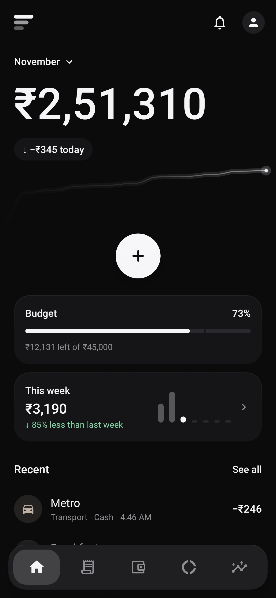
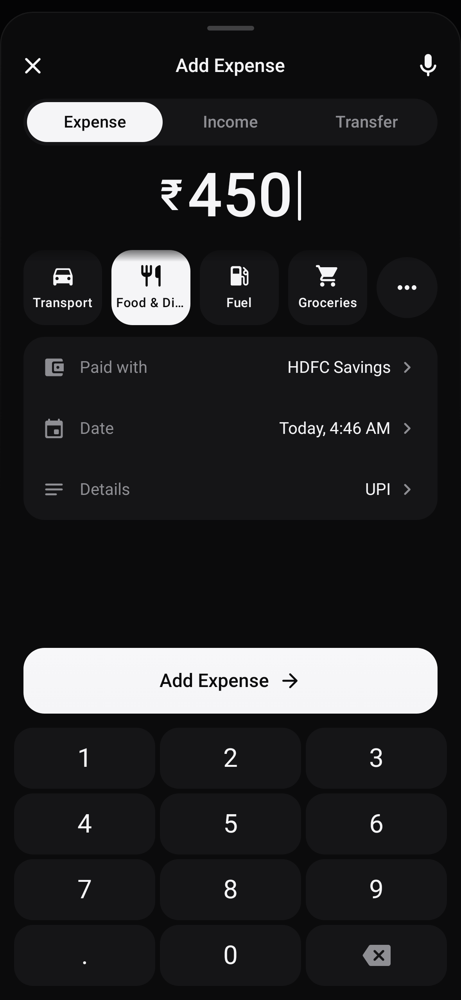
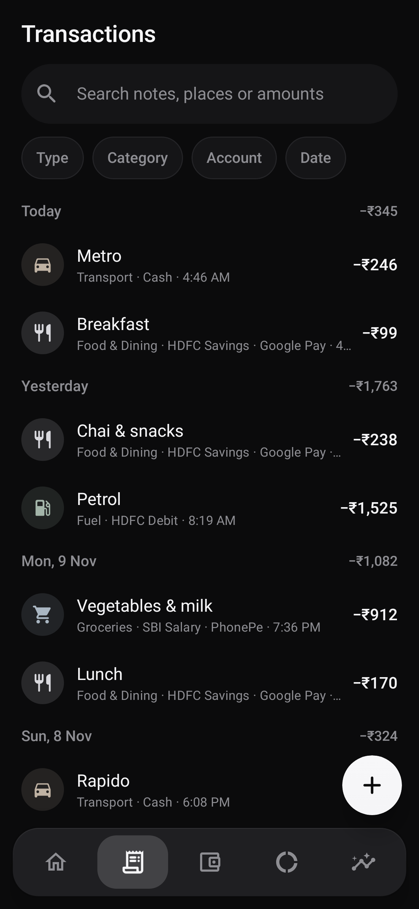
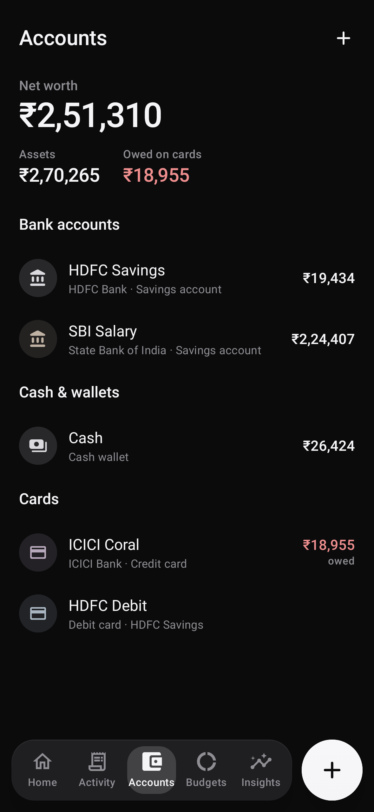
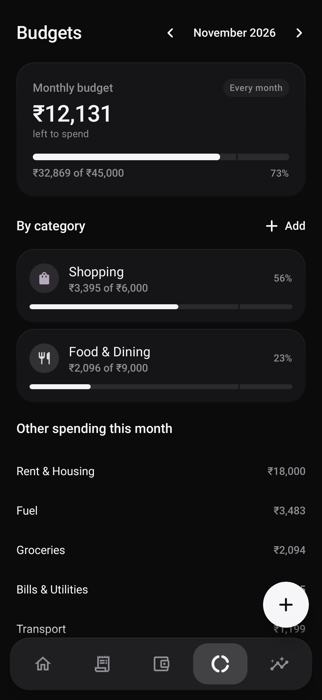
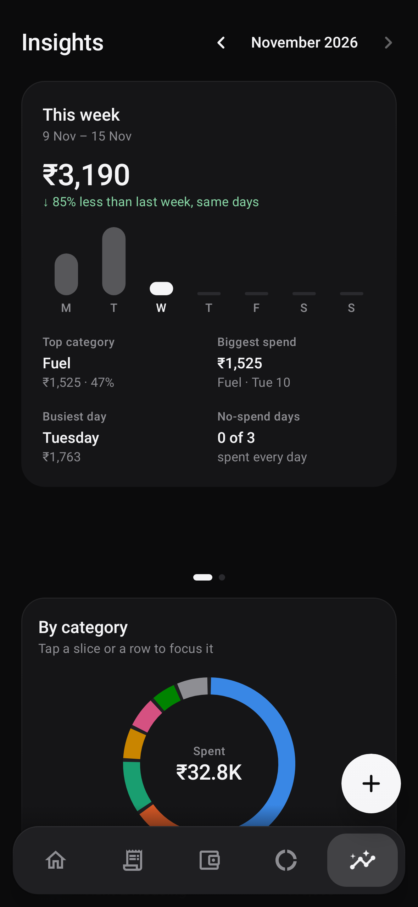
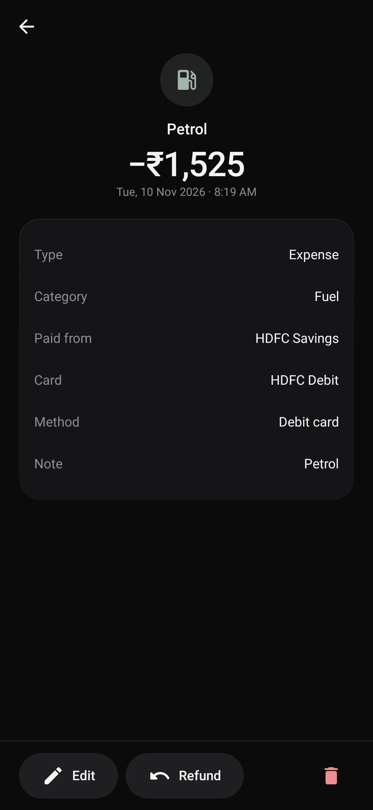
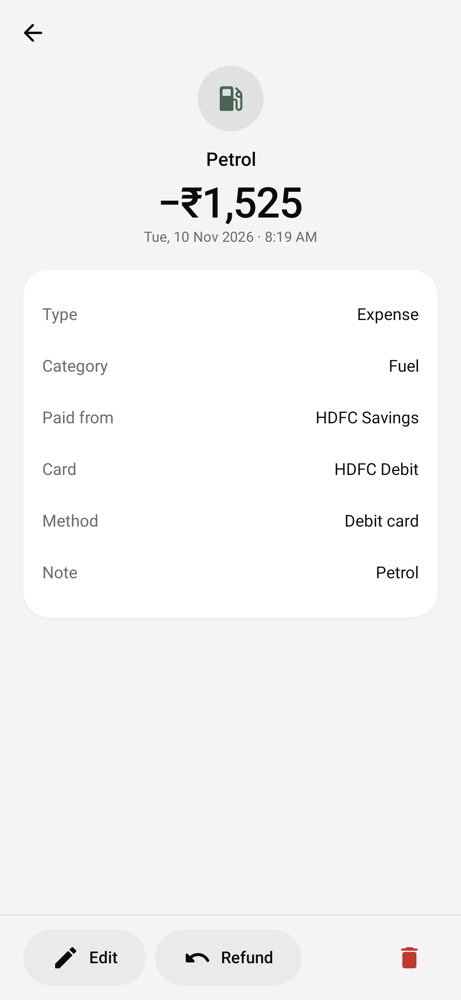

# MNYBOXD

<sub>Formerly Spendly. Same app, same data: it updates in place.</sub>

**A calm, private expense tracker for Android. Every rupee, accounted for.**

MNYBOXD records spending in seconds, by keypad or voice, and keeps accurate balances across
your bank accounts, cash, UPI, debit cards and credit cards. It works completely offline, has
no account or sign-in, and stores everything in an encrypted database on your phone.

Free. No ads. No tracking. No internet permission.

<h2 align="center">Download</h2>

<p align="center">
  <a href="https://github.com/Sharvesh-AR/MNYBOXD/releases/latest/download/MNYBOXD.apk">
    
  </a>
</p>

<p align="center">
  Grab the latest signed APK from the <a href="https://github.com/Sharvesh-AR/MNYBOXD/releases/latest">Releases</a> page.
  Sideloading requires enabling "Install unknown apps" for whichever app you download it with.
</p>

<p>
  
  
  
  
</p>
<p>
  
  
  
  
</p>

<sub>Screens are rendered from the real app UI with fictional sample data that exists only in debug
builds (`ScreenshotTest`).</sub>

## Features

**Fast entry**
* **Quick Add**: a sheet that slides up over whatever you were looking at and opens straight
  into the amount. Big digits that appear as you type, Expense / Income / Transfer, your four
  most used categories as tiles (*…* for the rest), then three rows: the account (the one you
  used last), the date, and *Details* (payment method, app and note, folded away until you need
  them). *Add Expense* sits right above the keypad. Double-taps can't create duplicates.
* **Voice entry**: say *"Spent 500 on petrol using PhonePe from SBI"*, *"120 rupees lunch"*,
  *"1500 shopping on ICICI credit card"* or *"80 coffee cash"*. A deterministic on-device parser
  extracts amount, description, category, payment method, app and account. **You always review
  the result before it is saved.**
* **Shortcut Pop-up (optional)**: from outside the app (the Quick Settings tile, home-screen
  widgets, the launcher shortcuts *Add expense* and *Voice expense*, the "Add expense" icon and
  the volume-button shortcut) Quick Add opens as a pop-up over the app you're in. Save or close
  it and you're straight back where you were.
* **Volume-button shortcut (optional)**: press volume down (or up) two or three times on any
  screen to open Quick Add. Your volume buttons keep working normally and the volume is put
  back afterwards. It ships in a separate build; see
  [Volume-button shortcut (optional)](#volume-button-shortcut-optional) for how to switch it on
  and what its accessibility permission can and can't do.
* **"Add expense" app icon** (optional): a second icon that opens Quick Add directly, so your
  phone's own gestures can launch it, such as back tap (Pixel *Quick Tap*) or double-pressing
  the side key (Samsung).
* **Home-screen widgets**: *Quick Add* (add or speak an expense), *Add income* (opens Quick Add
  on Income), *Expense + Income* (both buttons side by side), *Monthly overview* (spent this
  month, budget used and left, progress bar, last 7 days), *Account balance* (all accounts, or
  one account you pick; tap an account to open it), plus *Spending trend* and *Quick stats*.
  Each adapts to its size (touch and hold to resize), follows the app theme or one you choose,
  and updates when your data changes and just after midnight, without polling. Preview them and
  add them from *Settings → Widgets*.

**Accurate money**
* All amounts are integer paise (`Long`); floating point is never used for money.
* Expenses, income, transfers and refunds, with correct balance effects:
  * UPI from a bank account reduces that bank once ("Google Pay → HDFC → ₹500" is one expense).
  * Debit card payments come out of the linked bank account. Pick *Debit card* as the method
    on a savings or current account, or keep the card as its own account.
  * Credit card purchases increase the card's outstanding; paying the bill is a transfer from
    your bank to the card.
  * Bank-to-bank transfers are neither spending nor income.
  * Refunds reverse the original expense (partial refunds supported, never more than spent).
* Database-level integrity: foreign keys, unique idempotency keys, triggers rejecting invalid
  amounts, and atomic transactions.

**Understand your spending**
* **Home**: where you stand in two seconds. Just the MNYBOXD logo at the top, then your balance (everything in your accounts minus
  what you owe on cards, the same figure as Accounts) in large type, what you spent today, a
  faint line of the month's spending, one big **+** (tap to add, hold to speak), your budget,
  a *This week* glance (tap it for the full recap) and your latest transactions. Pick a month (*November ⌄*) to see that month's budget and
  spending; the bell lists budgets that have passed 80%; the profile icon opens Settings. Tap the
  balance for the breakdown.
* **Activity**: search notes, categories, accounts or amounts; filter by type, category,
  account and date; grouped by day with daily totals. Swipe a transaction left to delete it,
  with *Undo*.
* **Accounts**: savings, current, cash, wallets, debit and credit cards; net worth, assets and
  card dues; credit limit usage; archive or delete.
* **Budgets**: monthly overall and per-category limits with 80% and 100% warnings (also shown
  right after saving an expense that crosses a threshold). Each limit applies *Every month* or
  *Only this month*: give a festival month, a trip or a tight month its own amount, and every
  other month keeps the usual one. Months ahead can be planned too; *Use usual* undoes it.
* **Insights**: swipeable **weekly and monthly recaps** at the top (total spent and how it
  compares with the same days of the week or month before, a bar for each day, your top
  category, biggest expense, busiest day and no-spend days); then monthly
  spent, income, saved and daily average; daily, weekly and 6-month charts; category and
  payment-method breakdowns. The category donut uses six colours chosen to stay distinct for
  colour-blind eyes and on both themes, with smaller categories grouped as *Everything else*.
  Tap a slice or a row to bring it forward and see its amount. All from your real records.
* **Categories**: add your own, with a colour and an icon from a picker grouped the way people
  spend: food and drink, habits (cigarettes, vape, alcohol, beer, wine), getting around, home and
  bills, shopping, health, fun, travel, people and family, money and work.

**Your data, your control**
* Encrypted database (SQLCipher, key protected by Android Keystore).
* Password-encrypted backups and restore (validated, previewed, confirmed, all-or-nothing).
* CSV export for spreadsheets (with a clear "this file is unencrypted" warning).
* **Reset MNYBOXD** (*Settings → Data management*): deletes every transaction, account, budget,
  custom category and setting on the phone. Two separate confirmations: a warning that
  suggests a backup first, then a screen where you type `DELETE EVERYTHING` exactly.
* Optional screenshot blocking (*Hide app contents*).

**Themes**
* **Mono Dark** (default): matte black, white type, soft greys and charcoal surfaces, with colour
  only where it means something (money in, money over budget, chart slices).
* **Mono Light**: the same look inverted, paper white with ink-black type and buttons.
* Or *Match system* (Mono Dark in dark mode, Mono Light otherwise). The app icon follows your
  phone's dark mode too: white bars on black in dark mode, ink bars on white in light mode (with
  Android 13+ *Themed icons* on, it takes your wallpaper colours instead). Each styles every screen,
  sheet, dialog, chart, the dock and the widgets, applied instantly and remembered. Version 2.4
  retired Midnight, AMOLED and Ocean; if you used one, MNYBOXD opens in Mono Dark.

**Design and accessibility**
* **Your dock, your order**: the bottom dock is icons only (screen readers hear each name). Touch
  and hold a tab, slide it along and let go: the other tabs move aside and MNYBOXD remembers
  the order. A tap still just opens the tab. On every tab but Home, a small **+** floats above
  the dock.
* **Money moments**: after you save an expense, a solid silver ₹ coin (you can see its edge)
  spins about its axis inside a thin orbit as it eases into place, then *Expense Added!* and a
  check; income rises in with a small arrow; a transfer runs a line of dots from one account to
  the other. Back on Home the balance rolls to its new value like a fine mechanical counter
  (only the digits that changed move, each on a faint tile; income counts up), the budget bar
  follows, and the new transaction slides into the list. All of it plays only after the
  transaction is stored, takes about a second, and is skipped when animations are off.
* **No touch highlight**: nothing flashes grey when you tap. Whatever you touch presses in
  slightly and springs back.
* Origin-aware motion: accounts and transactions morph into their detail screens; dialogs
  expand from the control that opened them and collapse back into it; charts glide to new
  values. Everything respects Android's *Remove animations* setting.
* Haptics on keypad, selection, save, dock moves and errors.
* Screen reader labels for amounts, keypad, charts and rows; dock tabs can be moved with
  screen-reader actions (*Move before / after*); large touch targets; tabular figures for
  aligned amounts.

## Install on your phone

1. On your phone, tap the **Available on Android** badge above (or open
   [Releases](https://github.com/Sharvesh-AR/MNYBOXD/releases/latest)) to download `MNYBOXD.apk`. (Optionally compare its SHA-256 with
   `SHA256SUMS.txt` on the release page.)
2. Open the downloaded file. If Android asks, allow your browser or file manager to
   **install unknown apps** (Settings → Apps → *your browser* → Install unknown apps).
3. Tap **Install**, then **Open**.
4. You can switch the "install unknown apps" permission off again afterwards.

**Updating:** MNYBOXD has no internet permission, so it never checks for updates by itself. The
version you have is shown at the bottom of *Settings*; new versions appear on the
[Releases](https://github.com/Sharvesh-AR/MNYBOXD/releases/latest) page. Download `MNYBOXD.apk`
and install it over the top. Don't uninstall first: that deletes your records.

Requires Android 8.0 (API 26) or newer. Everything works offline. A few things depend on the
phone:

| Feature | Needs |
|---|---|
| Voice entry | A speech recognition service (for example Google's). On-device recognition is used when the phone has it. |
| Widgets that reshape as you resize them | Android 12 or newer. Older versions pick the closest layout when you resize. |
| *Add to home screen* button in *Settings → Widgets* | A launcher that supports pinning widgets (most do). Otherwise add them from the launcher's widget list. |
| Volume-button shortcut | The separate `MNYBOXD-volume-shortcut.apk` build (below). |

Updating keeps your data: every release is signed with the same key, so install the new
`MNYBOXD.apk` over the old one. Don't uninstall first, as that deletes your records.

To install from a computer instead: enable *Developer options → USB debugging*, connect the
phone and run `adb install MNYBOXD.apk`.

`MNYBOXD.apk` declares no accessibility service, notification listener or SMS permission, so
Google Play Protect does not block it when you install it from your browser or file manager.

### Volume-button shortcut (optional)

Press volume down (or up) two or three times on any screen to open Quick Add as a pop-up. It's
off until you switch it on:

1. Install `MNYBOXD-volume-shortcut.apk` (see below).
2. In MNYBOXD, open *Settings → Shortcut settings*, pick the button and *Twice* or *3 times*
   (the default).
3. Tap *Accessibility settings* and switch on **MNYBOXD volume shortcut**. If Android says
   *Restricted setting* (Android 13+ does this for apps installed outside an app store), open
   *App info → ⋮ → Allow restricted settings* and try again.

You can switch it off again in MNYBOXD (*Shortcut settings → Turn off*) or in Android's
Accessibility settings.

**What the accessibility permission is used for.** Android only lets an app notice button
presses made outside it through an accessibility service. MNYBOXD's asks for one capability,
filtering key events: it sees which hardware key was pressed and when. It can't read the screen
or other apps, receives no accessibility events, never blocks or changes a key press, and with
no internet permission nothing could leave the phone anyway. Your volume buttons keep working;
the volume is put back right after the pattern. It ignores the buttons while the phone is
ringing or on a call, and if the phone is locked it asks you to unlock before Quick Add opens.
*Twice* is quicker but can fire when you turn the volume down fast. Details in
[SECURITY.md](SECURITY.md#optional-accessibility-service-volume-button-shortcut).

**Why a separate build.** The volume-button shortcut needs an Android accessibility service. In some countries (India among
them) Google Play Protect's
[enhanced fraud protection](https://developers.google.com/android/play-protect/warning-dev-guidance)
blocks **any** app that declares one from being installed from a browser, messaging app or file
manager. You see *"App blocked to protect your device"*. It doesn't matter how little the
service can do. So the shortcut ships in a separate build, `MNYBOXD-volume-shortcut.apk`. It has
the same app, version and signing key, so either build installs as an update over the other and
keeps your data. Install it one of these ways:

* from a computer: `adb install -r MNYBOXD-volume-shortcut.apk` (USB debugging on), or
* through Google Play, if the app is published there (for example on an internal testing track).

Downloading it on the phone works only where that protection isn't active.

> **Back up regularly.** MNYBOXD has no cloud sync. If you uninstall the app or reset your phone,
> your records are gone unless you made an encrypted backup (*Settings → Data management →
> Create encrypted backup*).

## Build from source

Requirements: JDK 17 or 21, Android SDK with platform 37 (`platforms;android-37.0`) and
build-tools 36.0.0. The Gradle wrapper downloads Gradle 9.9.0 and verifies its checksum.

```bash
git clone <this repository>
cd spendly
echo "sdk.dir=$ANDROID_HOME" > local.properties     # if ANDROID_HOME isn't set for Gradle
./gradlew clean test lintStandardDebug lintVolumeShortcutDebug lintStandardRelease lintVolumeShortcutRelease assembleRelease
```

There are two builds (*product flavors*, see `app/build.gradle.kts`): **standard** (published as
`MNYBOXD.apk`) and **volumeShortcut** (adds the volume-button accessibility service from
`app/src/volumeShortcut/`; published as `MNYBOXD-volume-shortcut.apk`).

* Debug build (installs side by side as "io.github.sharveshar.spendly.debug"):
  `./gradlew installStandardDebug` or `./gradlew installVolumeShortcutDebug`
* Signed release APKs: `app/build/outputs/apk/standard/release/app-standard-release.apk` and
  `app/build/outputs/apk/volumeShortcut/release/app-volumeShortcut-release.apk`
  (if signing isn't configured, Gradle produces `…-release-unsigned.apk` instead).
* Google Play bundle: `./gradlew bundleVolumeShortcutRelease` (or `bundleStandardRelease`) →
  `app/build/outputs/bundle/<flavor>Release/`.
* Screenshots: `SPENDLY_SCREENSHOT_DIR=$PWD/docs/screenshots ./gradlew testStandardDebugUnitTest --tests '*ScreenshotTest*'`

### Release signing

Signing credentials are **never** stored in the repository. Gradle reads them from environment
variables or from your user-level `~/.gradle/gradle.properties`:

```properties
SPENDLY_KEYSTORE_FILE=/absolute/path/to/spendly-release.p12
SPENDLY_KEYSTORE_PASSWORD=...
SPENDLY_KEY_ALIAS=spendly
SPENDLY_KEY_PASSWORD=...
```

Create a keystore once (keep it **and** its password safe; you need the same key for every
future update):

```bash
keytool -genkeypair -v -storetype PKCS12 -keystore ~/spendly-release.p12 \
  -alias spendly -keyalg RSA -keysize 4096 -validity 10000 -dname "CN=MNYBOXD"
chmod 600 ~/spendly-release.p12
```

### Publish a release on GitHub

The workflow in `.github/workflows/android.yml` tests, lints and (when secrets exist) builds and
verifies signed APKs on every push. Pushing a tag `vX.Y.Z` that matches `versionName` publishes
a GitHub Release with `MNYBOXD.apk`, `MNYBOXD-volume-shortcut.apk` and their SHA-256 sums. The asset name never changes, so the
README badge (`releases/latest/download/MNYBOXD.apk`) always downloads the newest version.

1. Add repository secrets (Settings → Secrets and variables → Actions):
   * `SPENDLY_KEYSTORE_BASE64`: output of `base64 -w0 ~/spendly-release.p12`
   * `SPENDLY_KEYSTORE_PASSWORD`, `SPENDLY_KEY_ALIAS`, `SPENDLY_KEY_PASSWORD`
2. Bump `versionCode` and `versionName` in `app/build.gradle.kts`, commit and push.
3. Tag and push: `git tag v1.0.0 && git push origin v1.0.0`.

Without signing secrets the workflow still tests and lints, but never creates a release.

Prefer to publish manually? Build locally, then:

```bash
cp app/build/outputs/apk/standard/release/app-standard-release.apk MNYBOXD.apk
cp app/build/outputs/apk/volumeShortcut/release/app-volumeShortcut-release.apk MNYBOXD-volume-shortcut.apk
sha256sum MNYBOXD.apk MNYBOXD-volume-shortcut.apk > SHA256SUMS.txt
gh release create vX.Y.Z MNYBOXD.apk MNYBOXD-volume-shortcut.apk SHA256SUMS.txt --generate-notes
```

### Before publishing a release: device check

Automated tests run on the JVM (Robolectric). Before each public release, download `MNYBOXD.apk`
on a real phone and install it from the browser or file manager (this is the path Play Protect
checks), then check: first launch and onboarding; adding an expense, income, transfer and
refund; the coin animation and balances on Accounts; voice entry (allow and deny the microphone);
creating and restoring an encrypted backup; the Quick Settings tile; the "Add expense" app icon;
dragging a dock tab to a new place and restarting the app; every theme; adding, resizing,
tapping and removing each widget; opening and closing Quick Add repeatedly; rotating the phone;
and a large font size. Then install `MNYBOXD-volume-shortcut.apk` over it with `adb install -r`, confirm
your data is still there, and check the volume-button shortcut (in another app, on the lock
screen, during a call, that the volume returns to where it was, and that it stops once switched
off in Accessibility settings).

## Technology

Kotlin 2.4 · Jetpack Compose (Material 3) · MVVM with repositories · Room 2.8 on SQLCipher 4.20 ·
Coroutines/Flow · DataStore · Navigation Compose (type-safe) · kotlinx.serialization ·
Android `SpeechRecognizer` · Gradle Kotlin DSL with version catalog · AGP 9.5 · minSdk 26,
targetSdk 37.

```
app/src/main/java/io/github/sharveshar/spendly/
├── core/money/        Money: paise parsing/formatting, keypad input
├── domain/            Pure Kotlin rules: ledger & validation, insights & budgets, voice parser
├── data/              Room entities/DAOs, SQLCipher key manager, repositories, backup, prefs
├── ui/                Compose screens, components, motion, theme, navigation
├── shortcut/          Shortcut settings, volume-pattern detection, optional "Add expense" launcher entry
├── MainActivity.kt    Single activity, intent allow-list, shortcuts
└── QuickAddTileService.kt

app/src/volumeShortcut/  The volume-button accessibility service (volumeShortcut build only)
```

Testing: 114 automated tests (plus an opt-in screenshot test; each build runs 113, since one Settings test is build-specific) covering balance rules (including a randomized property test that
checks SQL balances against a reference calculator), validation, paise precision, duplicate
prevention, voice parsing, insights and budgets, database constraints and triggers, migrations,
encrypted backup round-trip and tamper detection, CSV injection, the Quick Add form logic (voice pre-fill, edit, refund, process-death restore),
the volume-button shortcut (press patterns, holding vs. pressing, volume restore, calls and ringing),
and Compose UI flows (navigation, Quick Add, validation, empty states, accessibility labels, Settings → Shortcuts), and each build's merged manifest (no SMS permission or notification listener in either build, and an accessibility
service only in the volumeShortcut build). `./gradlew test` runs the suite for both builds.
Each Robolectric test has a 2-minute limit and the test task a 15-minute one, so a hang fails fast in CI.

See [`DEPENDENCIES.md`](DEPENDENCIES.md) for every library, version and licence.

## Security and privacy

* No internet permission, no accounts, no analytics, no ads, no paid services, no API keys.
* Encrypted at rest; Android cloud backup disabled; you choose when and where to export.
* Never asks for passwords, PINs, OTPs, CVVs or card numbers.
* Voice uses your phone's speech service, which may work online on some devices. MNYBOXD tells
  you before first use and never stores audio.

Details and limitations: [`SECURITY.md`](SECURITY.md). Latest review:
[`docs/SECURITY_AUDIT.md`](docs/SECURITY_AUDIT.md).

## Roadmap

* Biometric / PIN app lock
* Recurring transactions and bill reminders (local notifications)
* Custom date range filter and export ranges
* Multiple currencies
* Translations (strings are currently English-only)
* Bundled premium typeface (currently the system font with tabular figures)

## License

MNYBOXD is free software: you can redistribute it and/or modify it under the terms of the
[GNU General Public License v3.0](LICENSE) as published by the Free Software Foundation, either
version 3 of the License, or (at your option) any later version.

It is distributed in the hope that it will be useful, but **without any warranty**; without even
the implied warranty of merchantability or fitness for a particular purpose. See the
[license](LICENSE) for details.

Copyright © 2026 ARS ([Sharvesh-AR](https://github.com/Sharvesh-AR)). Every source file carries
this copyright notice. Third-party libraries keep their own licences, listed in
[`DEPENDENCIES.md`](DEPENDENCIES.md).

**Additional terms** (GPL-3.0 section 7, full text in [`NOTICE`](NOTICE)):
* **Name and logo:** the licence doesn't cover the name *MNYBOXD*, its logo or the app icon. A
  modified or repackaged version must use a different name and icon and must not pose as the
  official app.
* **Attribution:** copies must keep the `NOTICE` file, the copyright notices and the in-app
  credit *Made with ❤️ by ARS*.

## Credits

Made with ❤️ by [**ARS**](https://ar-sharvesh.vercel.app)

<sub>The Android robot is reproduced or modified from work created and shared by Google and used
according to terms described in the Creative Commons 3.0 Attribution License.</sub>
